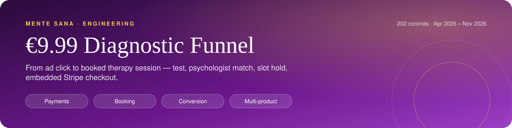
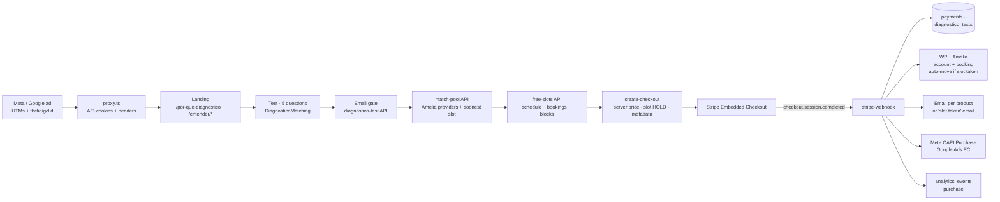

     

<h1 align="center">€9.99 Diagnostic Funnel: from ad click to booked session</h1>
<!-- /header -->

An end-to-end acquisition funnel for **Mente Sana**, an online psychology clinic in Spain (8,000+ patients, 150+ licensed psychologists). A visitor arrives from a paid ad, answers 5 questions, is matched with a real psychologist, picks a live slot from her calendar, pays €9.99 in an embedded Stripe checkout, and leaves with a confirmed video session, a confirmation email and a server-side conversion sent to the ad platform.

I designed, built, shipped and iterated on it in production: product, UX, frontend, backend, payments, tracking and experiments. This repo is an extract of that module with its **real git history (201 commits, Apr–Oct 2026)**.

---

## At a glance

<table>
  <tr>
    <td align="center" width="25%"><b>Product, UX, frontend, backend, payments</b> Role</td>
    <td align="center" width="25%"><b>Landing → test → match → checkout → webhook</b> Scope</td>
    <td align="center" width="25%"><b>Speech therapy &amp; nutrition launches</b> Reused for</td>
    <td align="center" width="25%"><b>97% mobile</b> Traffic</td>
  </tr>
</table>

## The problem

- Therapy is a hard first purchase. People arriving from an ad don't know what they need, don't know which psychologist to choose, and won't commit to a €50 session or a multi-session bundle with a stranger.
- **97% of paid traffic is mobile.** Every extra screen, form field or redirect loses people.
- Bookings live in a WordPress/Amelia scheduling system (MySQL, UTC). Payments live in Stripe. Analytics live in Supabase and Meta. "Paid, but the slot was taken" and "paid, but the ad platform never saw it" were both real failure modes.
- The business then wanted to launch **new products** (speech therapy, nutrition) without building a new funnel each time.

## What I built

| Stage | What it does |
|---|---|
| **Landings** | `/por-que-diagnostico` (control + challenger B, plus a "direct" variant that skips the test cover) and `/entender/[dolor]`: pain-angle landings (breakup, anxiety, dependency) driven by one data file, with a v2 redesign served at its own URL for split testing. |
| **Test** | 5-question mobile-first flow with a state machine (`intro → questions → contact → analyzing → schedule → payment`), email gate before the match, session restore from email/WhatsApp links. |
| **Matching** | Live pool from Amelia (only visible providers, filtered by profession via assigned service), ranked by soonest availability; fixed catalogue as fallback while loading or if Amelia is down. Licence numbers stripped from bios at the source. |
| **Slot selection** | Real free slots computed from each psychologist's weekly schedule, existing appointments (overlap by time range), manual blocks and days off, all in Europe/Madrid time. |
| **Checkout** | Stripe Embedded Checkout inside the page. The slot is **held** while the person pays. Price comes from a server-side table keyed by a token, never from a client-sent amount. |
| **Webhook** | Verifies signature, records the payment with UTMs/A-B variants/click IDs, creates the WordPress + Amelia account and booking, sends the right email, fires Meta CAPI `Purchase` and Google Ads enhanced conversions, and closes the internal analytics funnel. |
| **Products** | `productos-999.ts`: a single config object per product (questions, copy, Amelia service, Stripe naming, Meta labels, storage keys). The same funnel runs psychology, speech therapy and nutrition. |

## Screenshots

  
  
  

Landing (A/B winner) · Test + psychologist match · Pain-angle landing

## Architecture

## Key decisions & trade-offs

**One funnel, many products (config over forks).** Speech therapy was first built as a separate journey; I replaced it with the existing diagnostic funnel and moved every difference into `PRODUCTOS[slug]`. Components, `match-pool`, `free-slots`, `create-checkout`, the webhook and booking creation all read from it. Launching nutrition later was a new config entry, a question set and landings. Products not ready to sell (no Amelia service yet) are rejected server-side with a 503 instead of half-working.

**Hold the slot during payment, and never lie after it.** `create-checkout` places a short-lived hold on the chosen slot (the availability query skips holds older than 15 minutes). If the slot is still lost, the webhook books the nearest free one and emails the *real* time. Any booking failure sends a "we need to reschedule" email and flags the payment for manual review. A "session confirmed" email is never sent for a session that doesn't exist.

**Webhook built for retries and serverless.** It handles only `checkout.session.completed` (listening to `payment_intent.succeeded`/`charge.succeeded` too caused triple emails). Each email goes out after an atomic claim (`UPDATE … WHERE email_sent_at IS NULL`) that is released on failure. It accepts several signing secrets (one per Stripe endpoint), runs on the Node runtime with the raw body, and keeps the business logic in a dependency-injected `process.ts` so it can be unit tested without Next, Supabase or Stripe.

**Await side effects that look fire-and-forget.** CAPI and analytics calls are awaited. When they were fire-and-forget, the serverless runtime killed them as soon as the 200 went back to Stripe, and conversions were silently dropped. About 400 ms extra on a webhook is a fair price for that.

**Attribution that survives a cookie banner.** Under the Spanish data-protection (AEPD) consent banner the Meta pixel usually doesn't load, and purchases arrived with no `fbc`. The click ID is now captured server-side, the `fbc` is rebuilt from `fbclid` in the official format, and IP/UA travel through Stripe metadata into the CAPI `Purchase`. That event is labelled by product so Meta can tell a €9.99 entry purchase from a bundle.

**Experiments measured at the money, not the click.** `proxy.ts` assigns variants as cookies/headers. Landings render the right variant server-side (no flicker), bots always see the indexed control, and metadata/JSON-LD are identical across variants. Every variant cookie is stamped into Stripe metadata and persisted on `payments`, so conversion to *payment* per variant is a plain SQL query.

**Embedded checkout pragmatism.** `automatic_payment_methods` isn't accepted by embedded mode, and Bizum wasn't enabled on the account. Both broke checkouts in production, so the fix was `card` only: Apple Pay and Google Pay still appear on supported devices. In the one-screen variant, Stripe allows a single live embedded instance, so session creation is queued and the old instance is destroyed before a new one mounts.

**Time zones and dirty data are part of the product.** Amelia stores UTC MySQL datetimes. Slots are generated and displayed in Madrid time (handling CET/CEST), bookings block by real start–end range, and the last day of the window is fully covered. Provider names in marketing copy are resolved to Amelia records with progressive fallbacks.

**Next.js 16 module boundary.** Shared catalogues (`productos-999.ts`, `psychologists.ts`) are plain `.ts` modules with no `"use client"`. Importing an export from a client component into a route handler returns a client reference rather than the value. That quietly broke a server-side filter for weeks before it was traced.

## Impact

- **Mobile-first by necessity:** 97% of paid traffic is mobile, so the test, match, slot picker and checkout all fit a phone screen.
- **Experiment, Oct 21–28 2026:** keeping the test's cover page beat sending visitors straight to question 1: **8 paid vs 3**. The cover stayed.
- **Quality of the €9.99 entry purchase (May–Sep 2026):** **85%** of buyers attend their session, and **57%** buy a therapy bundle within 30 days.
- **Reuse:** the parametrised funnel launched **speech therapy and nutrition** as new €9.99 products on the same code path.

## Code tour

| Path | What to look at |
|---|---|
| `src/lib/productos-999.ts` | Product parametrisation: the `Producto999` interface and the diagnostic / speech therapy / nutrition configs. |
| `src/app/test-diagnostico/DiagnosticoMatching.tsx` | Funnel state machine, email gate, match, calendar, embedded checkout, session restore, A/B hooks. |
| `src/app/test-diagnostico/PagoUnaPantalla.tsx` | "One screen" variant: psychologist + preselected slot + Stripe on one view; queued checkout instances. |
| `src/app/test-diagnostico/psychologists.ts` | Fixed fallback catalogue (and why it lives in a plain module). |
| `src/app/api/diagnostico/match-pool/route.ts` | Live provider pool from Amelia, profession by service, soonest-availability ranking, licence-number scrubbing. |
| `src/app/api/diagnostico/free-slots/route.ts` | Slot generation from real schedules, range overlap, holds, Madrid time. |
| `src/app/api/diagnostico-test/route.ts` | Saves answers/scores/profile before payment (one row per person, by email). |
| `src/app/api/create-checkout/route.ts` | Server-side price, slot hold, attribution + A/B metadata, Stripe Embedded Checkout session. |
| `src/app/api/stripe-webhook/route.ts` | Signature verification (multi-secret), event routing, CAPI, analytics, failed/expired payments. |
| `src/app/api/stripe-webhook/process.ts` | Pure, dependency-injected fulfilment: payments upsert, booking, idempotent emails. |
| `src/app/por-que-diagnostico/*` | Landing control/challenger with server-side variant selection and shared SEO. |
| `src/app/entender/*` | Pain-angle landings from one data file (`_data/dolores.ts`), v1 and v2. |
| `src/lib/productos-catalogo.ts` | Product inference/badges used by internal panels to label bookings. |

## Testing

- **Vitest unit tests** for the webhook's fulfilment logic (`process.test.ts`). They cover: payment recorded and the right email chosen per product, the diagnostic path left unchanged when other products are added, the ebook branch with and without a PDF attachment, email still sent if the payments upsert fails, no email when there is no address, email failure propagated, and metadata-name precedence.
- **Routing isolation tests** (`nutricion-routing.test.ts`). An unconfigured product returns an empty pool without querying Amelia, only the right profession enters each pool, and products are identified from source/path/metadata without prefix collisions.
- Everything else (UI flows, experiments) was verified in production through Stripe test events, analytics and per-variant payment queries. There are no end-to-end tests in this extract.

## Stack

Next.js 16 (App Router, `proxy.ts`) · React · TypeScript · Tailwind CSS · Stripe (Embedded Checkout, webhooks) · Supabase (Postgres) · WordPress + Amelia (MySQL) for scheduling · Meta Conversions API · Google Ads Enhanced Conversions · Brevo transactional email · Vitest · Vercel

## About this repo

This is a **read-only showcase**, extracted from a private production monorepo with its git history preserved for these paths. It **is not runnable on its own**: it imports shared modules that aren't included (`proxy.ts`, Amelia/WordPress clients, email templates, CAPI helpers, the slot-hold and pricing libraries, partner attribution) and needs live Stripe, Supabase and Amelia credentials. Secrets and personal data were redacted. Code comments and commit messages are in Spanish, the team's working language.

Author: **Alejandro Álvarez**, CTO at Mente Sana.
